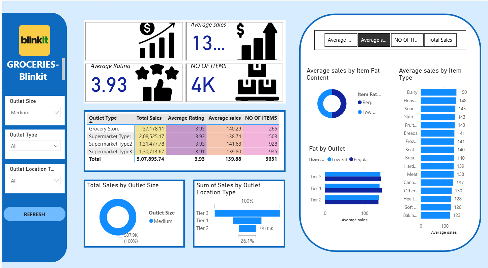

# Blinkit Grocery Sales Dashboard

This project is a Power BI dashboard created to analyze Blinkit grocery sales data. It gives an overview of sales performance across different outlet types, item categories, and outlet sizes.

## Dashboard Preview

## Key Insights

- Total sales and average sales across different outlets.
- Average customer rating and number of items sold.
- Sales distribution across different item categories.
- Comparison of sales based on outlet size and location.
- Analysis of low-fat and regular-fat products.

## Tools Used

- Power BI
- Power Query
- DAX

## Dashboard Features

- Interactive filters for outlet size, outlet type, and location.
- KPI cards for important sales metrics.
- Charts to compare sales across different categories.
- Outlet-wise sales analysis.

## Project File

The Power BI dashboard file (`.pbix`) is available in this repository. You can download it and open it using Power BI Desktop.

## About

This project was created as a data analytics project to practice data visualization and explore sales trends using Power BI.
